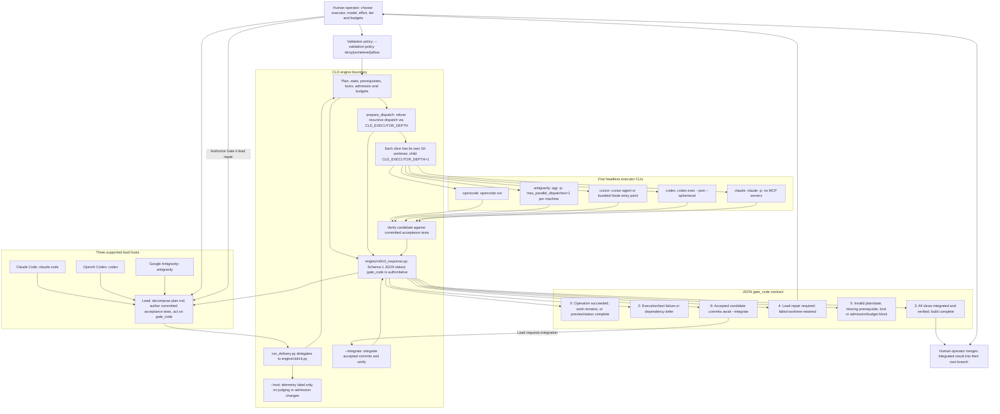

# Level 1: System Context & Cross-LLM Trust Boundaries

## Architectural Overview

This view separates the human operator, three supported lead hosts, the CLD engine, and five headless executor CLIs. The human chooses the executor, model, effort, tier, validation policy (`--validation-policy deny|unmetered|allow`) and budgets, authorizes Gate 4 repairs, and merges the integrated result into their own branch.

A lead running in Claude Code (`claude-code`), OpenAI Codex (`codex`), or Google Antigravity (`antigravity`) decomposes `plan.md`, authors committed acceptance tests, and acts on `gate_code`. The `--host` flag supplies a telemetry label only; it never changes judging or admission.

The `run_delivery.py` entry point delegates to `engine/cld/cli.py`, with responses assembled by `engine/cld/cli_response.py`. Schema-1 JSON on stdout carries the authoritative `gate_code`: on Windows a shell wrapper may report exit 1 for any failure, so the lead must read the JSON code. Each executor child runs in its slice's own Git worktree with `CLD_EXECUTOR_DEPTH=1`; the engine refuses recursive dispatch. Accepted candidate commits still await `--integrate`, and build completion requires all slices to be integrated and verified.

**MCP adapter (v0.7.0+).** Each lead host can also drive CLD through the optional `cld` MCP server (`scripts/cld_mcp.py`) instead of a shell: the same driver runs underneath, long commands run as durable jobs, and executors never see the tools. See [Level 3E](10-l3e-mcp-adapter.md).

## Rendered Diagram

## Component & Contract Breakdown

| Component | Responsibility and boundary |
| --- | --- |
| Human operator | Chooses executor/model/effort/tier, validation policy and budgets; authorizes Gate 4 lead repairs; merges the integrated result into their own branch. |
| Lead hosts | `claude-code`, `codex`, and `antigravity` support the lead role: decompose `plan.md`, author committed acceptance tests, and act on `gate_code`. |
| `run_delivery.py` and `engine/cld/cli.py` | Entry point and engine CLI boundary for plan/state checks, prerequisites, locks, admission, budgets and dispatch. |
| `--host` | Telemetry label only; does not change judging or admission. |
| Validation policy | The operator selects `--validation-policy` with `deny`, `unmetered`, or `allow`. |
| Recursion guard | `prepare_dispatch` in `engine/cld/cli.py` refuses recursive dispatch using `CLD_EXECUTOR_DEPTH`. Providers start the child with `CLD_EXECUTOR_DEPTH=1`. |
| Slice worktrees | Each slice runs in its own Git worktree, with candidate work subject to engine verification against committed acceptance tests. |
| Integration | Gate 6 means accepted commits await `--integrate`; Gate 3 means all slices have been integrated and verified. The human merges the integrated result into their own branch. |
| `engine/cld/cli_response.py` | Emits Schema-1 JSON on stdout. The JSON `gate_code` is authoritative even when a Windows shell wrapper reports exit 1 for a failure. |

| `gate_code` | Meaning | Lead action |
| --- | --- | --- |
| `0` | Operation succeeded; work remains, or preview/status is complete. | Act on the command result; this alone does not establish build completion. |
| `2` | Execution/test failure or dependency defer. | Inspect the failure or deferred dependency. |
| `3` | All slices integrated and verified; build complete. | Return the integrated result to the human for merging into their own branch. |
| `4` | Lead repair required; failed worktree retained. | Obtain human authorization for lead repair of the retained worktree. |
| `5` | Invalid plan/state, missing prerequisite, lock or admission/budget block. | Resolve the reported block. |
| `6` | Accepted candidate commits await `--integrate`. | Request integration and act on the resulting gate. |

All five executors run behind the worktree and recursion boundaries. The command forms below describe the headless CLI contracts; placeholders denote the supplied prompt, model, worktree or effort, and square brackets mark an optional argument.

| Executor | Headless CLI contract | Source and constraint |
| --- | --- | --- |
| `opencode` | `opencode run <prompt> -m <model> --format json --dir <worktree>` | `engine/cld_providers/opencode/provider.py` |
| `antigravity` | `agy -p <prompt> --model <model> --add-dir <worktree> --dangerously-skip-permissions --output-format json [--effort <e>]` | `engine/cld_providers/antigravity/provider.py`; one dispatch at a time per machine (`max_parallel_dispatches=1`). |
| `cursor` | `cursor-agent -p <prompt> --output-format json --workspace <worktree> --model <model> --force --trust` | `engine/cld_providers/cursor/provider.py`, `_cursor_invocation`; may use the bundled Node entry point. |
| `codex` | `codex exec --json --ephemeral --sandbox workspace-write` with the prompt on stdin. | `engine/cld_providers/codex/contract.py`; `danger-full-access` is used only for evidence/full-access runs. |
| `claude` | `claude -p --output-format json --model <model> --effort <e> --safe-mode --restricted --strict-mcp-config --mcp-config '{"mcpServers":{}}' --tools Read,Edit,Write,Glob,Grep,Bash --permission-mode dontAsk ... --no-session-persistence` | `engine/cld_providers/claude/contract.py`; the executor runs with no MCP servers. The ellipsis omits further arguments. |

Lead host identifiers and executor identifiers describe separate roles: `claude-code` identifies a lead host and `claude` identifies a headless executor. `codex` and `antigravity` support both roles. Every provider starts its child with `CLD_EXECUTOR_DEPTH=1`, and executor output must pass engine verification before acceptance.
