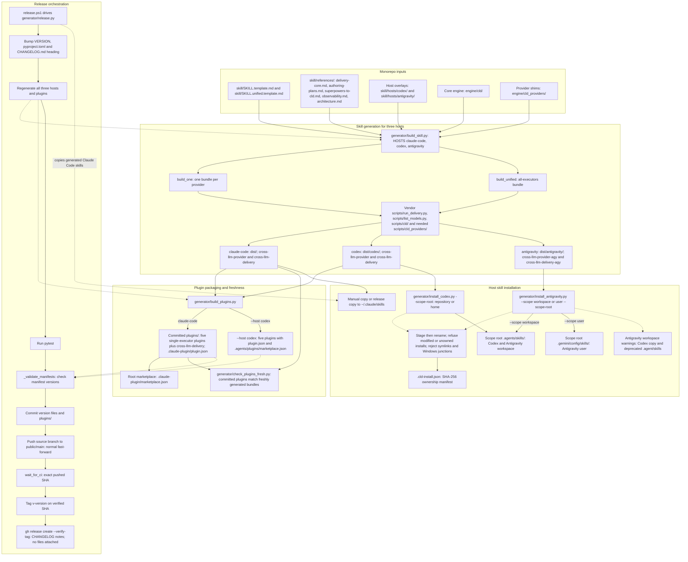

# Level 2A: Build-Time Skill & Plugin Generator Pipeline

## Architectural Overview

This view follows shared templates, host overlays, the core engine and provider shims through skill generation, plugin packaging, release and installation. `generator/build_skill.py` supports `HOSTS = ("claude-code", "codex", "antigravity")`. Generated bundles carry their runtime code; plugin packaging supports Claude Code and Codex only in v0.6.0.

Freshness checking compares committed Claude Code plugins with newly packaged bundles. Release validation checks generated manifest versions and waits for CI on the exact pushed SHA before tagging and publishing. The Codex and Antigravity installers enforce ownership and filesystem boundaries before replacing an installed skill.

## Rendered Diagram

## Component & Contract Breakdown

Solid arrows show source inputs, artifact flow, release order or installation destinations. Dotted arrows show orchestration, validation inputs and installer contracts. The release path is summarized: regeneration and manifest validation also occur within the release workflow. The freshness check is a comparison of committed Claude Code output, rather than a check of Codex packages.

| Component | Inputs and outputs | Contract |
| --- | --- | --- |
| Shared templates and references | `skill/SKILL.template.md`, `skill/SKILL.unified.template.md`, and `skill/references/` | Shared references are `delivery-core.md`, `authoring-plans.md`, `superpowers-to-cld.md`, `observability.md` and `architecture.md`. |
| Host overlays | `skill/hosts/codex/`, `skill/hosts/antigravity/` | Host-specific inputs accompany the shared templates. The three supported hosts are `claude-code`, `codex` and `antigravity`. |
| Runtime sources | `engine/cld/`, `engine/cld_providers/` | Generated bundles vendor the core engine and the needed provider shims. |
| `generator/build_skill.py` | `build_one` generates one bundle per provider; `build_unified` generates the all-executors bundle | Both forms are produced for all three hosts. The diagram's word `provider` is a placeholder for a provider name. |
| Vendored payload | `scripts/run_delivery.py`, `scripts/list_models.py`, `scripts/cld/`, `scripts/cld_providers/
/` | Each bundle includes its runtime entry points, engine and needed provider code; the unified bundle includes all executors. |
| Claude Code bundles | `dist/cross-llm-<provider>/`, `dist/cross-llm-delivery/` | Default host output is directly beneath `dist/`. |
| Codex bundles | `dist/codex/cross-llm-<provider>/`, `dist/codex/cross-llm-delivery/` | Codex output is beneath `dist/codex/`. |
| Antigravity bundles | `dist/antigravity/cross-llm-<provider>-agy/`, `dist/antigravity/cross-llm-delivery-agy/` | Antigravity adds `-agy` to both single-provider and unified skill names. |
| `generator/build_plugins.py`: Claude Code | Generated Claude Code skills become committed packages under `plugins/` | Five single-executor plugins plus `cross-llm-delivery` carry `.claude-plugin/plugin.json` and are listed in the root `.claude-plugin/marketplace.json`. |
| `generator/build_plugins.py --host codex` | Generated Codex skills become five plugins | Packages contain `plugin.json`; `.agents/plugins/marketplace.json` is the local catalog. Plugin packaging has no Antigravity host mode in v0.6.0. |
| `generator/check_plugins_fresh.py` | Committed `plugins/` compared with freshly generated bundles | Verifies that the committed Claude Code plugin tree matches generated output. |
| `release.ps1` and `generator/release.py` | Version files, generated bundles, plugins and CHANGELOG notes | Orchestrate the release sequence below, including `_validate_manifests` and `wait_for_ci`. |
| `generator/install_codex.py --scope-root <dir>` | Codex bundles installed beneath `<dir>/.agents/skills/` | The scope root can be a repository root or the home folder for a user-wide installation. |
| `generator/install_antigravity.py --scope workspace --scope-root <dir>` | Antigravity bundles installed beneath `<dir>/.agents/skills/` | Workspace installation warns about a Codex copy of the same skill and the deprecated `.agent/skills` folder. |
| `generator/install_antigravity.py --scope user --scope-root <dir>` | Antigravity bundles installed beneath `<dir>/.gemini/config/skills/` | User scope uses the Gemini skills destination. |
| Shared installer safety | Stage the bundle, then rename it into place | Both installers refuse modified or unowned installs and reject symlinks and Windows junctions in the bundle and on the path to the destination. |
| `.cld-install.json` | SHA-256 ownership manifest | Records ownership of installed files so updates can refuse modified or unowned content. |
| Claude Code skill copy | Generated Claude Code skills copied to `~/.claude/skills` | Skills are copied by hand or by the release step; there is no Claude installer script. |

The release sequence implemented by `generator/release.py`, driven by `release.ps1`, is:

1. Bump `VERSION`, `pyproject.toml` and the `CHANGELOG.md` heading.
2. Regenerate all three hosts' bundles and the plugins, run pytest, and check manifest versions with `_validate_manifests`. Regeneration precedes pytest so freshness tests see the new version.
3. Commit the version files and `plugins/`, then push the source branch to `public/main` using a normal fast-forward.
4. Use `wait_for_ci` to wait for CI on that exact SHA, then tag `v<version>` on it.
5. Run `gh release create --verify-tag` with the CHANGELOG section as notes and no files attached. The release workflow also copies Claude Code skills to `~/.claude/skills`.
