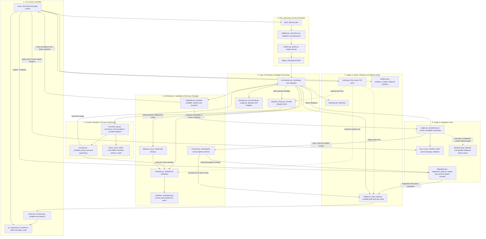

# Level 2B: Runtime Engine Subsystems (engine/cld/)

## Architectural Overview

This view groups the modules of `engine/cld/` into seven runtime subsystems and shows their delivery flow and supporting dependencies. Provider implementations live alongside the core in `engine/cld_providers/`. The arrows describe responsibilities and handoffs, rather than a Python import graph.

Plan admission precedes dispatch of a ready DAG layer. Each slice runs in an isolated Git worktree, and baseline preflight runs before the executor. The engine captures a candidate tree and verifies it in a frozen snapshot. Acceptance records the slice as `done` and preserves its commit; explicit integration merges accepted commits and verifies the integration tests before recording `integrated`.

## Rendered Diagram

## Component & Contract Breakdown

Paths in the table are relative to `engine/cld/`, except for the sibling provider package `engine/cld_providers/`.

| Runtime subsystem | Components | Responsibility and contract |
| --- | --- | --- |
| 1. CLI & Gate Controller | `cli.py`, `cli_response.py`, `status.py`, `summary.py` | Controls delivery commands and progress reporting. Schema-1 JSON exposes the authoritative `gate_code`. The acceptance pytest runner is `pytest_test_runner` in `cli.py`. |
| 2. Plan, Admission & DAG Scheduler | `plan/`, `validate.py`, `admission.py`, `dag.py`, `models.py`, `picker.py` | Handles the delivery plan, admission and model validation, model choices, and topological DAG layers before dispatch. |
| 3. Layer Orchestrator & Budget Accounting | `orchestrator.py`, `dispatch_limits.py`, `attempts.py`, `accounting.py`, `usage.py` | Coordinates slice worktrees, baseline preflight, dispatch, candidate judging, retries, and usage accounting. Dispatch slots enforce provider limits; Antigravity allows one dispatch at a time per machine. |
| 4. Git Worktree, Candidate & Recovery Manager | `worktree.py`, `candidate.py`, `recovery.py`, `repair.py`, `gc.py`, `_windows_workspace.py` | Manages isolated worktrees, candidate capture and snapshots, recovery checkpoints, accepted commits, repair, and cleanup. The Windows helper grants the current user Modify access on a newly created worktree before dispatch. |
| 5. Provider Dispatch & Process Supervisor | `providers_api.py`, `executors/`, `engine/cld_providers/`, `process.py`, `native_cli.py`, `_windows_job.py` | Connects provider adapters to supervised child execution in the slice worktree. `native_cli.py` resolves the CLI's native executable without a platform shell. Providers set `CLD_EXECUTOR_DEPTH=1`; `prepare_dispatch` in `cli.py` refuses dispatch while that variable is set. |
| 6. Judge & Integration Gate | `judge.py`, `acceptance.py`, `test_run.py`, `integration.py`, `integration_gate.py`, optional `behavioral.py` | Checks the captured candidate against protected inputs, the file allowlist, and acceptance tests in a frozen snapshot. `test_run.py` defines `TestRun` and legacy runner adapters. Integration merges accepted commits and checks the frozen integration selector before recording success. |
| 7. Ledger, Locking, Telemetry & Evidence Mode | `ledger.py`, `build_state.py`, `locking.py`, `telemetry.py`, `evidence.py`, `evidence_mode/` | Groups durable build and slice state, OS file ownership, telemetry, and evidence facilities. `locking.py` supplies `file_owner` for the ledger, worktree registry, and dispatch-slot locks. |

The candidate and integration boundaries are:

- **Baseline and capture:** `CandidateVerifier.preflight` in `candidate.py` runs the acceptance test on the base before dispatch. Candidate capture produces a Git tree; judging uses a frozen snapshot of that tree. Protected acceptance inputs and changes outside the slice's file allowlist are refused.
- **Acceptance and recovery:** On a passing judge result, `RecoverySession.collect()` in `recovery.py` writes the accepted commit ref. The accepted slice's ledger status is `done`. Failed attempts provide judge feedback for retries; exhausted attempts retain the failed worktree for repair.
- **Integration:** `--integrate --integration-tests <selector>` merges accepted commits and runs the frozen integration selector against a frozen snapshot. Only passing integration tests permit the integration ref and ledger status `integrated`. A failed integration records `integration_failure` and yields Gate 4.
- **Optional behavioral evaluation:** `behavioral.py` provides an LLM-graded deepeval `GEval` check. It runs only when configured, is off unless deepeval is installed, and is outside the default judge. Its result is not deterministic.
- **Windows permissions:** `_windows_workspace.py` applies the current-user Modify ACL grant before dispatch. It creates no junctions and installs no dependencies.
- **Health stub:** `_skeleton.py` contains only a three-line `healthcheck()` stub returning `"cld-ok"`; it performs no verification and is excluded from the judge flow.

| Persisted contract | Exact name or value | Owner and meaning |
| --- | --- | --- |
| Ledger | `.cld-ledger.json` | `ledger.py` records build and slice state. An accepted slice has status `done`; `verified` is not a ledger state. |
| Ledger writer lock | `.cld-ledger.json.lock` | `Ledger.writer()` uses the OS lock supplied by `locking.py` through `file_owner`. |
| Ledger owner record | `.cld-ledger.json.owner.json` | Owner record written by the ledger writer. |
| Worktree registry lock | `cld-worktrees.lock` | Worktree registry operations use the same `file_owner` OS-lock primitive. |
| Slice worktree | `.cld/worktrees/<slice-slug>-<run_id[:8]>-<session_id>/` | Default worktree location managed by `worktree.py`. |
| Accepted commit | `refs/cld/accepted/<session_id>` | `RecoverySession.collect()` preserves the accepted candidate for integration. |
| Integration commit | `refs/cld/integration/<run_id>/<integration_id>` | Written only after integration verification passes. |

`cli_response.py` reports these gate outcomes through `gate_code`:

| Gate | Meaning |
| --- | --- |
| 0 | Operation succeeded; work remains, or preview/status completed. |
| 2 | Execution/test failure or dependency defer. |
| 3 | All slices integrated and verified; build complete. |
| 4 | Lead repair required; failed worktree retained. |
| 5 | Invalid plan/state, missing prerequisite, lock, or admission/budget block. |
| 6 | Accepted candidate commits await explicit integration. |
