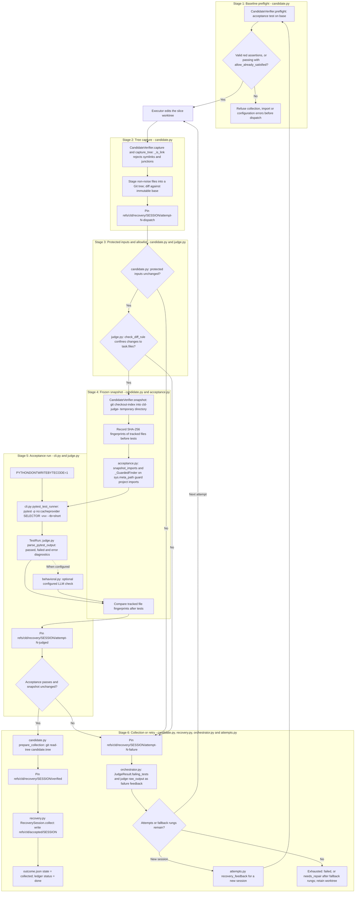

# Level 3B: Candidate Capture & Multi-Stage Judge Verification Funnel

## Architectural Overview

This view follows six stages from baseline preflight to collection or retry. `CandidateVerifier` in `engine/cld/candidate.py` captures the candidate against an immutable base and supplies a frozen snapshot for acceptance. Protected inputs and the slice allowlist constrain edits; import guarding and tracked-file fingerprints protect the verification boundary.

The acceptance result comes from the test run. Recovery checkpoints preserve dispatch, judged, verified and failure trees under `refs/cld/recovery/`. Passing verification leads to collection under `refs/cld/accepted/`, recovery session state `collected` in `outcome.json`, and ledger status `done`. Failed verification supplies feedback for another attempt or leaves the worktree retained when attempts and fallback rungs are exhausted.

## Rendered Diagram

## Component & Contract Breakdown

All module paths below are relative to `engine/cld/`. The six numbered rows correspond to the diagram's stages; snapshot fingerprint comparison occurs after the acceptance run.

| Stage | Owning components | Contract and outcome |
| --- | --- | --- |
| 1. Baseline preflight | `candidate.py`: `CandidateVerifier.preflight` | Run the acceptance test on the base before dispatch. A valid red baseline has `rc == 1`, no errors, and every failure is an `assert` or `AssertionError`. Collection, import and configuration errors are refused. A passing baseline is accepted only with `allow_already_satisfied`. |
| 2. Tree capture | `candidate.py`: `capture_tree`, `CandidateVerifier.capture`, `_is_link` | Walk the worktree, refusing symlinks and junctions. Stage non-noise files into a Git tree and diff it against the immutable base. The session pins `refs/cld/recovery/<session_id>/attempt-<n>-dispatch`. |
| 3. Protected inputs and allowlist | `candidate.py`: protected set; `judge.py`: `check_diff_rule` | Refuse changes to protected inputs and require every changed file to be in `task.files`. Both requirements apply to the candidate. |
| 4. Frozen snapshot | `candidate.py`: `CandidateVerifier.snapshot`; `acceptance.py`: `snapshot_imports`, `_GuardedFinder` | `git checkout-index` materialises the candidate tree in `TemporaryDirectory(prefix="cld-judge-")`. Take SHA-256 fingerprints of tracked files before the test run and compare them afterwards. `_GuardedFinder` on `sys.meta_path` prevents project imports from resolving to source outside the snapshot. |
| 5. Acceptance run | `cli.py`: `pytest_test_runner`; `test_run.py`: `TestRun`; `judge.py`: `parse_pytest_output` | Run `pytest -p no:cacheprovider <selector> -vvv --tb=short` with `PYTHONDONTWRITEBYTECODE=1`. Return a `TestRun`; parse passed and failed counts and error diagnostics. The session pins `refs/cld/recovery/<session_id>/attempt-<n>-judged`. The optional `behavioral.py` LLM check runs only when configured. |
| 6. Collection or retry | `candidate.py`: `prepare_collection`; `recovery.py`: `RecoverySession.collect()`; `orchestrator.py`: retry routing; `attempts.py`: `recovery_feedback()` | On pass, prepare the verified tree, pin `verified`, and collect the accepted commit. On failure, pin the failure checkpoint and supply the judge's failing-test output to the next attempt. A new session also receives recovery feedback. Exhaustion retains the worktree with slice status `failed`, or `needs_repair` after fallback rungs. |

The protected set includes the acceptance test, `conftest.py`, `pytest.ini`, `pyproject.toml`, `setup.cfg`, `tox.ini`, `.gitattributes`, and the plan's `protected_inputs`. Membership in `task.files` does not permit changing a protected input.

The behavioral check in `behavioral.py` is optional and LLM-graded, requires deepeval, and is off by default. It is not a deterministic stage of the default judge.

| Recovery ref or record | Meaning |
| --- | --- |
| `refs/cld/recovery/<session_id>/attempt-<n>-dispatch` | Preserve the captured dispatch tree. |
| `refs/cld/recovery/<session_id>/attempt-<n>-judged` | Preserve the judged tree. |
| `refs/cld/recovery/<session_id>/attempt-<n>-failure` | Preserve failure evidence for retry or retained work. |
| `refs/cld/recovery/<session_id>/verified` | Pin the verified tree on the passing collection path. |
| `refs/cld/accepted/<session_id>` | `RecoverySession.collect()` writes the accepted commit ref. |
| `outcome.json` | Record recovery session `state = "collected"` after collection. |
| `.cld-ledger.json` | Record slice `status = "done"` after acceptance and collection. |

On the passing path, `prepare_collection` runs `git read-tree <candidate.tree>` before the verified checkpoint and accepted ref are written. On the failing path, the next attempt receives `JudgeResult.failing_tests` and the judge's `raw_output` as failing-test feedback; a new session also receives `recovery_feedback()` from `attempts.py`. When attempts and rungs run out, the worktree remains available with the failure status described above.

In the diagram, `SESSION` and `N` stand for `<session_id>` and `<n>` in the exact refs listed in the table. `SELECTOR` stands for the configured acceptance selector.
