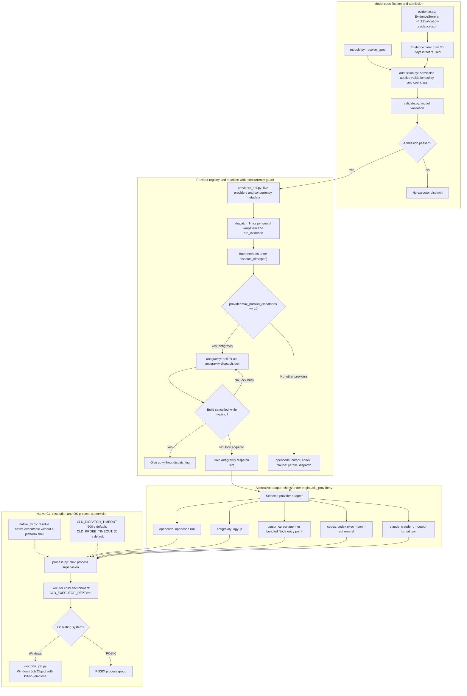

# Level 3C: Provider Dispatch, Model Policy & OS Process Supervision

## Architectural Overview

This view follows model resolution and admission through the provider concurrency guard, adapter selection, and OS process supervision. `Admission` applies validation policy and cost class using evidence from `EvidenceStore`; evidence older than 30 days is not reused.

The executor wrapper makes both `run` and `run_evidence` enter `dispatch_slot(spec)`. Antigravity waits for a machine-wide lock and gives up without dispatching if the build is cancelled. The other four providers dispatch in parallel. Executor children receive `CLD_EXECUTOR_DEPTH=1`, bounded timeouts, and process-tree containment through a Windows Job Object or POSIX process group.

## Rendered Diagram

## Component & Contract Breakdown

| Component | Responsibility and contract |
| --- | --- |
| `engine/cld/models.py`: `resolve_spec` | Parses `<provider>:<model>@<effort>[+fast]` for model resolution and admission. |
| `engine/cld/admission.py`: `Admission` | Applies validation policy and cost class using validation evidence. Its default `max_age_seconds=30 * 86400` means evidence older than 30 days is not reused. |
| `engine/cld/validate.py` | Supplies model validation for admission. |
| `engine/cld/evidence.py`: `EvidenceStore` | Stores validation evidence at `~/.cld/validation-evidence.json`. This evidence store is separate from the dispatch lock. |
| `engine/cld/providers_api.py` | Provider registry for `opencode`, `antigravity`, `cursor`, `codex`, and `claude`, including the `max_parallel_dispatches` capability. |
| `engine/cld/dispatch_limits.py`: `guard()` | Wraps the executor so both `run` and `run_evidence` enter `dispatch_slot(spec)`. |
| `dispatch_slot(spec)` | When `provider.max_parallel_dispatches == 1`, takes the provider dispatch lock, polling until free. Cancellation while waiting gives up without dispatching. Antigravity has this limit; the other four providers dispatch in parallel. |
| Adapter shims under `engine/cld_providers/` | Translate the selected provider into its headless CLI invocation. The branches in the diagram represent alternative providers. |
| `engine/cld/native_cli.py` | Resolves a CLI's native executable without a platform shell. Its dotted connection identifies supporting process-launch functionality. |
| `engine/cld/process.py` | Supervises executor children, using the recursion environment setting, timeout bounds, and OS process-tree containment shown in the diagram. |
| `CLD_EXECUTOR_DEPTH` | Executor children receive `CLD_EXECUTOR_DEPTH=1`; the engine refuses recursive dispatch while the variable is set. |
| `CLD_DISPATCH_TIMEOUT` | Bounds dispatch runs; defaults to 600 seconds. |
| `CLD_PROBE_TIMEOUT` | Bounds probes; defaults to 30 seconds. |
| `engine/cld/_windows_job.py` | Holds the Windows child tree in a Job Object with kill-on-job-close semantics. POSIX supervision uses a process group. |

| Dispatch lock | Location and behavior |
| --- | --- |
| `cld-antigravity-dispatch.lock` | Machine-wide Antigravity serialization, including dispatches from separate repositories. |
| Windows directory | `%LOCALAPPDATA%\cld\locks` |
| Other platforms' directory | `~/.cache/cld/locks` |
| Override | `CLD_DISPATCH_LOCK_DIR` overrides the lock directory. |

The guard holds the slot around the selected executor call. Admission determines whether execution may proceed; the concurrency guard determines when the admitted call can dispatch.

The following command forms are those specified in the corrected reference facts. Angle-bracket values are placeholders; optional arguments appear in square brackets.

| Adapter | Headless command and contract | Source |
| --- | --- | --- |
| `opencode` | `opencode run <prompt> -m <model> --format json --dir <worktree>` | `engine/cld_providers/opencode/provider.py` |
| `antigravity` | `agy -p <prompt> --model <model> --add-dir <worktree> --dangerously-skip-permissions --output-format json [--effort <e>]` | `engine/cld_providers/antigravity/provider.py` |
| `cursor` | `cursor-agent -p <prompt> --output-format json --workspace <worktree> --model <model> --force --trust`; may use its bundled Node entry point instead. | `engine/cld_providers/cursor/provider.py`: `_cursor_invocation` |
| `codex` | `codex exec --json --ephemeral`, prompt on stdin, with `--sandbox workspace-write`. Uses `danger-full-access` only for evidence/full-access runs. | `engine/cld_providers/codex/contract.py` |
| `claude` | `claude -p --output-format json --model <model> --effort <e> --safe-mode --restricted --strict-mcp-config --mcp-config '{"mcpServers":{}}' --tools Read,Edit,Write,Glob,Grep,Bash --permission-mode dontAsk ... --no-session-persistence`. The executor runs with no MCP servers. | `engine/cld_providers/claude/contract.py` |
