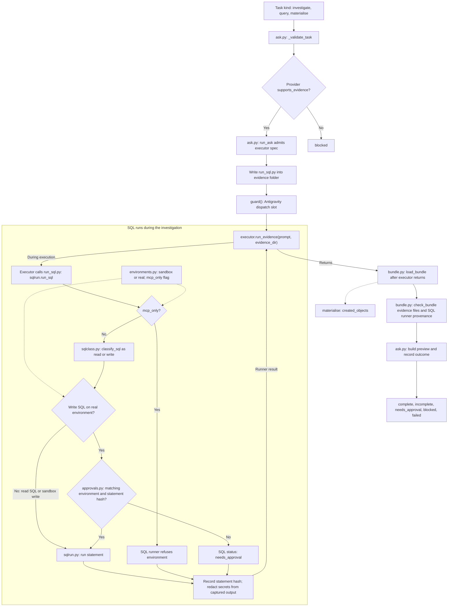

# Level 3D: Evidence Mode Pipeline (Investigate, Query, Materialise)

## Architectural Overview

This view follows evidence tasks through `engine/cld/evidence_mode/`: task validation and admission, executor dispatch, SQL runs during the investigation, and bundle checks after the executor returns. `ask.py` accepts the task kinds `investigate`, `query`, and `materialise`. Materialise tasks create objects and list them as `created_objects`.

`run_ask` refuses providers without `supports_evidence`, admits the executor spec, writes a `run_sql.py` launcher into the evidence folder, and calls `executor.run_evidence(prompt, evidence_dir)`. Evidence dispatches take the Antigravity slot through `guard()`. This path uses no Git worktree or diff capture.

SQL execution is governed by the environment class and statement classification. Reads never need approval; writes on a sandbox run; writes on a real environment require an approval matching that environment and statement hash. Environments marked `mcp_only` are refused by the SQL runner. Bundle validation checks evidence files and SQL runner provenance before `ask.py` builds a preview and records the outcome.

## Rendered Diagram

## Component & Contract Breakdown

Module paths are relative to `engine/cld/evidence_mode/`, except `guard()` in `engine/cld/dispatch_limits.py`.

| Component | Responsibility and contract |
| --- | --- |
| Task and `ask.py` `_validate_task` | Accepts `investigate`, `query`, and `materialise`. Materialise tasks create objects and list them as `created_objects`. |
| `ask.py` `run_ask` | Refuses providers without `supports_evidence`, admits the spec, writes the `run_sql.py` launcher into the evidence folder, and dispatches `executor.run_evidence(prompt, evidence_dir)`. Unsupported providers yield `blocked`. Evidence execution uses no Git worktree or diff capture. |
| `guard()` and executor | Evidence dispatches also take the Antigravity slot. The executor calls the launcher during the investigation and returns before bundle checks. |
| `environments.py` | Supplies an environment class, `sandbox` or `real`, and its `mcp_only` flag to the SQL execution decisions. |
| `run_sql.py` and `sqlrun.py` `run_sql` | The launcher invokes the SQL runner. The runner refuses `mcp_only` environments, applies the SQL approval rule, and otherwise runs the statement. It records the statement hash and redacts secrets from captured output. |
| `sqlclass.py` `classify_sql` | Classifies a statement as read or write. Read starts are `SELECT`, `WITH`, `SHOW`, `DESCRIBE`, `DESC`, and `EXPLAIN`. |
| `approvals.py` | Holds approvals matching an environment and statement hash. Only write SQL on a `real` environment needs a matching approval; without it the SQL runner returns `needs_approval`. Reads never need approval, and sandbox writes run. |
| `bundle.py` `load_bundle` | Reads the evidence bundle after the executor returns, including `created_objects` for materialise tasks. |
| `bundle.py` `check_bundle` | Checks required evidence files and runner provenance: SQL results must come from `run_sql.py` runs. |
| Preview and outcome in `ask.py` | Builds a preview and records the outcome: `complete`, `incomplete`, `needs_approval`, `blocked`, or `failed`. SQL statuses in the inner loop are distinct from the final task outcome. |

The SQL loop runs inside executor execution. Bundle loading and validation follow the executor's return; they do not precede the investigation.

Outside this pipeline, `kb_template.json` is the knowledge-base scaffold copied by `run_delivery.py --init-kb <dir>`. `citations.py` checks repository-file citations inside that knowledge base. Neither is an evidence bundle pipeline stage.
