# Level 4A: Slice Lifecycle, Ledger Reconciliation & Crash Recovery State Machine

## Architectural Overview

A slice has two separately persisted state layers: `ledger.py` stores `LedgerEntry.status` in `.cld-ledger.json`, while `recovery.py` stores a `RecoverySession` state in `outcome.json`. The parallel regions show how accepted collection connects session evidence to slice completion. The choice nodes represent decisions, not stored states.

The normal ledger path is `pending` → `in_progress` → `done` → `integrated`. Session verification and collection are separate: `verified` pins a recovery tree, and `collected` records the accepted commit. Gate `6` requests integration of accepted work; Gate `3` requires all slices integrated and verified. Reconciliation checks for completed collection before dispatch, and redispatch of a `needs_repair` entry requires conclusive evidence that work never started.

## Rendered Diagram

```mermaid
stateDiagram-v2
    direction TB
    state "Slice status and recovery evidence" as Slice {
        state "LedgerEntry.status in .cld-ledger.json" as Ledger {
            state "pending" as pending
            state "in_progress" as in_progress
            state "done" as done
            state "integrated" as integrated
            state "failed" as LedgerFailed
            state "needs_repair" as needs_repair
            state CollectionCheck <<choice>>
            state StartCheck <<choice>>
            state RepairCheck <<choice>>
            [*] --> pending
            pending --> CollectionCheck : --step; recover_collected before dispatch
            LedgerFailed --> CollectionCheck : Next --step retries; recover_collected first
            CollectionCheck --> done : Matching collected session, accepted commit, base and tests_fingerprint
            CollectionCheck --> in_progress : No matching collection; dispatch
            in_progress --> done : Accepted commit collected; Gate 6
            in_progress --> LedgerFailed : Attempts ran; candidate failed; Gate 2
            in_progress --> needs_repair : Every fallback rung failed; Gate 4
            in_progress --> pending : AdmissionBlocked, quota or final executor error; report deferred
            done --> integrated : --integrate; integration tests pass
            integrated --> [*] : Gate 3 once all slices integrated and verified
            needs_repair --> StartCheck : repository_refs and never_started
            StartCheck --> CollectionCheck : Conclusive never_started; check collection before redispatch
            StartCheck --> needs_repair : Existing evidence or inconclusive refs; Gate 4
            LedgerFailed --> RepairCheck : --mark-repaired retained work
            needs_repair --> RepairCheck : --mark-repaired retained work
            RepairCheck --> done : Repair verifies and collects; Gate 6
            RepairCheck --> needs_repair : Repair attempt fails; Gate 4
            note right of pending
                deferred is a reported result; save pending
                ledger.py accepts stored deferred from older ledgers
            end note
            note right of needs_repair
                build_state.py legacy-ledger migration can set needs_repair
                never_started requires attempts == 0 and no commit
                Every recorded session must be a plain delivery session
                No session branch, accepted ref, recovery ref or worktree may exist
                Redispatch overwrites status; no reset to pending is required
            end note
            note right of done
                Integration failure records build.integration_failure; Gate 4
            end note
        }
        --
        state "RecoverySession state in outcome.json" as Recovery {
            state "reserved" as reserved
            state "running" as running
            state "verified" as verified
            state "collected" as collected
            state "failed" as SessionFailed
            state "cleanup_unconfirmed" as cleanup_unconfirmed
            [*] --> reserved
            reserved --> running : Worktree created
            running --> verified : Verified tree pinned
            verified --> collected : RecoverySession.collect writes accepted ref
            running --> SessionFailed : Failure; attempt checkpoint pinned
            running --> cleanup_unconfirmed : ProcessCleanupError
            note right of verified
                refs/cld/recovery/<session_id>/verified
            end note
            note right of collected
                refs/cld/accepted/<session_id>
                Matching collection permits ledger done after a crash
            end note
            note right of SessionFailed
                refs/cld/recovery/<session_id>/attempt-<n>-failure
            end note
        }
    }
```

## Component & Contract Breakdown

| Ledger status or reported result | Contract and transitions |
| --- | --- |
| `pending` | Awaits dispatch. Before dispatch, `recover_collected()` checks for matching collection evidence; a match makes the slice `done` without dispatching again. Otherwise dispatch sets `in_progress`. |
| `in_progress` | Dispatched slice. Accepted collection sets `done`; failed attempts yield `failed`, while exhaustion of every fallback rung yields `needs_repair`. |
| `done` | An accepted commit has been collected at `refs/cld/accepted/<session_id>`; Gate `6` requests `--integrate`. |
| `integrated` | `--integrate` passed integration tests. Gate `3` means all slices are integrated and verified. |
| `failed` | Attempts ran and the candidate did not pass; Gate `2`. The next `--step` retries the slice. It does not become `needs_repair` automatically. The lead can also fix retained work and use `--mark-repaired <slice-id>`. |
| `needs_repair` | Gate `4`. Set when every fallback rung fails, a `--mark-repaired` attempt fails, or legacy-ledger migration requires repair. It remains until repair unless `never_started(refs)` conclusively permits redispatch; the new dispatch overwrites its status. |
| Reported `deferred` | A runtime result, not a newly stored status: admission (`AdmissionBlocked`), quota or a final executor error blocks dispatch, and `orchestrator.py` saves `pending`. The ledger loader still accepts stored `"deferred"` from older ledgers. |

An integration failure also yields Gate `4` through `build.integration_failure`; this is a build record, separate from a slice's `needs_repair` status.

| Recovery session state in `outcome.json` | Contract and evidence |
| --- | --- |
| `reserved` | Recovery session reserved before its worktree is created. |
| `running` | Worktree created. The session can reach verification or record failure evidence. |
| `verified` | The verified tree is pinned at `refs/cld/recovery/<session_id>/verified`. |
| `collected` | `RecoverySession.collect()` wrote `refs/cld/accepted/<session_id>` and recorded collection in `outcome.json`. This evidence can restore ledger `done` after a crash. |
| `failed` | Failure checkpoint pinned at `refs/cld/recovery/<session_id>/attempt-<n>-failure`. |
| `cleanup_unconfirmed` | `ProcessCleanupError` records that process cleanup was not confirmed. This session state does not establish that work never started. |

| Component or decision | Recovery contract |
| --- | --- |
| `engine/cld/ledger.py` / `LedgerEntry` | Owns ledger status and the `never_started(refs)` evidence check. |
| `engine/cld/recovery.py` / `RecoverySession` | Owns session state in `outcome.json`, recovery checkpoints under `refs/cld/recovery/`, and collection under `refs/cld/accepted/`. |
| `recover_collected()` | Runs before any dispatch of a slice. A session must have reached `collected`, and its accepted commit, `base` and `tests_fingerprint` must still match. A match promotes the slice to `done` without another dispatch. |
| `engine/cld/worktree.py` / `repository_refs()` | Supplies refs using `git for-each-ref --format=%(refname)`. Any stderr warning or non-ref output line raises `CaptureError`; this is inconclusive evidence, not proof of absence. |
| `LedgerEntry.never_started(refs)` | Applies only to `needs_repair` with `attempts == 0`, no commit, and recorded sessions that are all plain delivery sessions: no repair, migration or recovery ref recorded. Every session must lack a branch, accepted ref, recovery ref and worktree. |
| `engine/cld/orchestrator.py` | Checks collected evidence before dispatch, retries failed slices on `--step`, reports blocked dispatches as `deferred` while storing `pending`, and marks exhausted fallback rungs `needs_repair`. |
| `engine/cld/build_state.py` | Legacy-ledger migration can set `needs_repair`. |
| `engine/cld/repair.py` / `--mark-repaired <slice-id>` | Accepts retained work from `failed` or `needs_repair`. Successful verification and collection sets `done`; a failed repair attempt sets `needs_repair`. Integration remains a separate step. |

The `never_started(refs)` check covers every recorded session's branch (`refs/heads/<branch>`), `refs/cld/accepted/<session_id>`, `refs/cld/recovery/<session_id>/*`, and worktree, including the entry's worktree path. Only conclusive absence permits redispatch. Existing evidence or an inconclusive `repository_refs()` result keeps the entry in `needs_repair` until `--mark-repaired <slice-id>`.
