# Level 4B: On-Disk & Git Ref Storage Topology

## Architectural Overview

CLD stores state in three scopes: the target repository working tree, the Git common directory, and user-level locations. The working tree contains the ledger, active-run pointer, managed worktrees and run artifacts. Git branches identify slice and integration worktrees; recovery refs preserve checkpoints, accepted refs identify slice commits, and integration refs are written only after integration tests pass.

Ledger writes, the Git worktree registry and Antigravity dispatch use separate locks. User-level dispatch locks and validation evidence have different storage roots. On Windows, `_windows_workspace.py` grants the current user Modify access on newly created worktrees via `icacls.exe`.

Solid arrows show containment; dotted, labeled arrows show ownership or runtime relationships. Braces in the diagram denote variable path components. All named components are under `engine/cld/`.

## Rendered Diagram

```mermaid
flowchart TB
    subgraph WORKING["Target repository working tree: {repo}/"]
        ROOT["Repository root"]
        LEDGER[".cld-ledger.json: Schema-2 build manifest and entries slice map"]
        LOCK[".cld-ledger.json.lock: Ledger.writer() single-writer lock"]
        OWNER[".cld-ledger.json.owner.json: ledger writer owner record"]
        CURRENT[".cld/current-run.json: active run_id and ledger pointer"]
        WORKTREES[".cld/worktrees/"]
        SLICE_TREE["{slice-slug}-{run_id[:8]}-{session_id}/"]
        INTEGRATION_TREE["integration-{run_id[:8]}-{integration_id}/"]
        RUNS[".cld/runs/{run_id}/"]
        BUILD["build.json"]
        EVENTS["events.jsonl"]
        SESSION["{slice_id}/{session_id}/"]
        OUTCOME["outcome.json"]
        BASELINE["attempt-0/: baseline preflight run"]
        ATTEMPT["attempt-{n}/"]
        DISPATCH_FILES["dispatch.txt, dispatch.json, dispatch.patch"]
        TEST_FILES["tests-{k}.txt, tests-{k}.json"]
        JUDGE_FILES["judge.txt, judge.json, judged.patch"]
        PROCESSES["processes/"]
        INTEGRATION_FILES["integration/{integration_id}/"]
        REPORTS["summaries/, usage/, validation/"]
        ROOT --> LEDGER
        ROOT --> LOCK
        ROOT --> OWNER
        ROOT --> CURRENT
        ROOT --> WORKTREES
        ROOT --> RUNS
        WORKTREES --> SLICE_TREE
        WORKTREES --> INTEGRATION_TREE
        RUNS --> BUILD
        RUNS --> EVENTS
        RUNS --> SESSION
        SESSION --> OUTCOME
        SESSION --> BASELINE
        SESSION --> ATTEMPT
        ATTEMPT --> DISPATCH_FILES
        ATTEMPT --> TEST_FILES
        ATTEMPT --> JUDGE_FILES
        ATTEMPT --> PROCESSES
        RUNS --> INTEGRATION_FILES
        RUNS --> REPORTS
    end
    subgraph GIT["Git store: {repo}/.git/ resolved by --git-common-dir"]
        STORE["Git common directory"]
        REGISTRY_LOCK["cld-worktrees.lock: registry_owner"]
        SLICE_BRANCH["cld/{run_id}/{slice-slug}/{session_id}"]
        INTEGRATION_BRANCH["cld/{run_id}/integration/{integration_id}"]
        RECOVERY["refs/cld/recovery/{session_id}/"]
        CHECKPOINTS["attempt-{n}-dispatch, attempt-{n}-judged, attempt-{n}-failure, verified"]
        ACCEPTED["refs/cld/accepted/{session_id}"]
        INTEGRATED["refs/cld/integration/{run_id}/{integration_id}"]
        STORE --> REGISTRY_LOCK
        STORE --> SLICE_BRANCH
        STORE --> INTEGRATION_BRANCH
        STORE --> RECOVERY
        RECOVERY --> CHECKPOINTS
        STORE --> ACCEPTED
        STORE --> INTEGRATED
    end
    subgraph DISPATCH_STATE["User-level dispatch coordination"]
        LOCK_DIRECTORY["Windows: %LOCALAPPDATA%/cld/locks/; elsewhere: ~/.cache/cld/locks/"]
        OVERRIDE["CLD_DISPATCH_LOCK_DIR: lock directory override"]
        DISPATCH_LOCK["cld-antigravity-dispatch.lock"]
        LOCK_DIRECTORY --> DISPATCH_LOCK
        OVERRIDE -. "overrides lock directory" .-> LOCK_DIRECTORY
    end
    subgraph VALIDATION_STATE["User-level validation evidence: ~/.cld/"]
        EVIDENCE["~/.cld/validation-evidence.json: EvidenceStore default path"]
    end
    subgraph COMPONENTS["Storage owners in engine/cld/"]
        WRITER["ledger.py: Ledger.writer()"]
        STATE["build_state.py: publish_current()"]
        TELEMETRY["telemetry.py"]
        WORKTREE["worktree.py: managed_location() and registry_owner"]
        WINDOWS["_windows_workspace.py: current-user Modify access via icacls.exe"]
        RECOVER["recovery.py: RecoverySession.pin_tree() and RecoverySession.collect()"]
        INTEGRATION["integration.py"]
        LIMITS["dispatch_limits.py"]
        VALIDATION["evidence.py: EvidenceStore"]
    end
    WRITER -. "acquires" .-> LOCK
    WRITER -. "writes owner record" .-> OWNER
    WRITER -. "writes ledger" .-> LEDGER
    STATE -. "publishes active run pointer" .-> CURRENT
    STATE -. "writes build manifest" .-> BUILD
    TELEMETRY -. "records events" .-> EVENTS
    WORKTREE -. "acquires registry lock" .-> REGISTRY_LOCK
    WORKTREE -. "selects slice worktree location" .-> SLICE_TREE
    WINDOWS -. "grants Modify access on new worktrees" .-> WORKTREES
    SLICE_TREE -. "uses branch" .-> SLICE_BRANCH
    INTEGRATION_TREE -. "uses branch" .-> INTEGRATION_BRANCH
    RECOVER -. "records session outcome" .-> OUTCOME
    RECOVER -. "pin_tree preserves checkpoints" .-> RECOVERY
    RECOVER -. "collect writes accepted commit ref" .-> ACCEPTED
    INTEGRATION -. "merges accepted commits" .-> ACCEPTED
    INTEGRATION -. "uses integration worktree" .-> INTEGRATION_TREE
    INTEGRATION -. "records integration artifacts" .-> INTEGRATION_FILES
    INTEGRATION -. "writes ref only after integration tests pass" .-> INTEGRATED
    LIMITS -. "coordinates Antigravity dispatch" .-> DISPATCH_LOCK
    VALIDATION -. "stores validation evidence" .-> EVIDENCE
```

## Component & Contract Breakdown

| Repository state | Storage and contract |
| --- | --- |
| `.cld-ledger.json` | Schema-2 ledger containing the `build` manifest and `entries` slice map. |
| `.cld-ledger.json.lock` | Single-writer lock acquired by `Ledger.writer()` in `engine/cld/ledger.py`. |
| `.cld-ledger.json.owner.json` | Owner record associated with the ledger writer. |
| `.cld/current-run.json` | Active `run_id` and ledger pointer published by `publish_current()` in `engine/cld/build_state.py`. |
| `.cld/worktrees/<slice-slug>-<run_id[:8]>-<session_id>/` | Slice worktree location selected by `managed_location()` in `engine/cld/worktree.py`. |
| `.cld/worktrees/integration-<run_id[:8]>-<integration_id>/` | Integration worktree used by `engine/cld/integration.py` to merge accepted commits. |
| `engine/cld/_windows_workspace.py` | Grants the current Windows user Modify access on each new worktree via `icacls.exe`. |

All run artifacts below are relative to `.cld/runs/<run_id>/`.

| Run artifact | Storage and contract |
| --- | --- |
| `build.json` | Run build manifest written by `build_state.py` through `publish_current()`. |
| `events.jsonl` | Event stream recorded by `engine/cld/telemetry.py`. |
| `<slice_id>/<session_id>/outcome.json` | Per-session outcome recorded by `RecoverySession` in `engine/cld/recovery.py`. |
| Session `attempt-0/` | Baseline preflight run. |
| Session `attempt-<n>/` | Attempt directory containing dispatch, test, judge and process artifacts. |
| Attempt `dispatch.txt`, `dispatch.json`, `dispatch.patch` | Dispatch output, metadata and patch evidence. |
| Attempt `tests-<k>.txt`, `tests-<k>.json` | Test output and test result records. |
| Attempt `judge.txt`, `judge.json`, `judged.patch` | Judge output, result and judged patch evidence. |
| Attempt `processes/` | Process artifacts for the attempt. |
| `integration/<integration_id>/` | Integration artifacts. |
| `summaries/`, `usage/`, `validation/` | Run summaries, usage and validation artifacts. |

The Git store is the common directory resolved by `--git-common-dir`, represented as `<repo>/.git/` in this view. Branch names and refs below are Git storage names.

| Git storage or ref | Storage and contract |
| --- | --- |
| `cld-worktrees.lock` | Worktree registry lock held by `registry_owner` in `worktree.py`; separate from the ledger writer lock. |
| `cld/<run_id>/<slice-slug>/<session_id>` | Slice worktree branch. |
| `cld/<run_id>/integration/<integration_id>` | Integration worktree branch. |
| `refs/cld/recovery/<session_id>/` | Checkpoints pinned by `RecoverySession.pin_tree()`: `attempt-<n>-dispatch`, `attempt-<n>-judged`, `attempt-<n>-failure`, and `verified`. |
| `refs/cld/accepted/<session_id>` | Accepted slice commit ref written by `RecoverySession.collect()`. |
| `refs/cld/integration/<run_id>/<integration_id>` | Integration result ref written only after the integration tests pass. |

User-level dispatch coordination and validation evidence occupy separate locations.

| User-level state | Storage and contract |
| --- | --- |
| `%LOCALAPPDATA%\cld\locks\cld-antigravity-dispatch.lock` | Windows Antigravity dispatch lock managed by `engine/cld/dispatch_limits.py`. |
| `~/.cache/cld/locks/cld-antigravity-dispatch.lock` | Corresponding dispatch lock outside Windows. |
| `CLD_DISPATCH_LOCK_DIR` | Overrides the dispatch-lock directory. |
| `~/.cld/validation-evidence.json` | Default path of `EvidenceStore` in `engine/cld/evidence.py`. |
