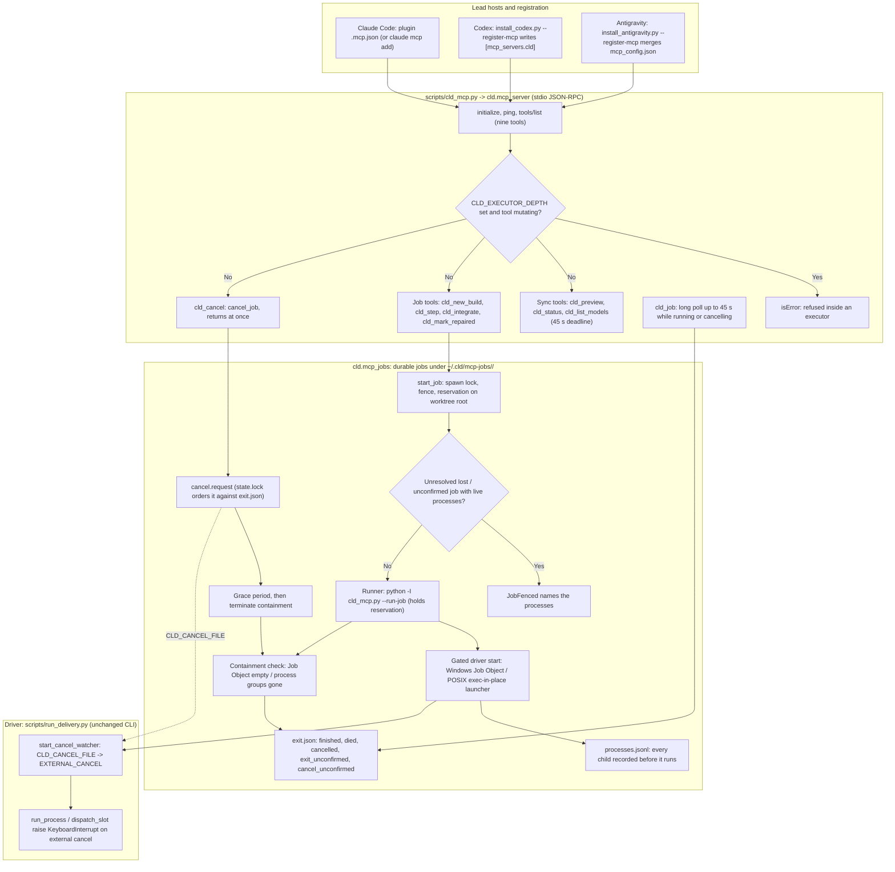

# Level 3E: MCP Adapter, Durable Jobs & Cancellation

## Architectural Overview

The optional MCP adapter (v0.7.0, cancellation in v0.7.1) lets a lead host drive CLD through typed tools instead of a shell. `scripts/cld_mcp.py` runs a dependency-free stdio JSON-RPC server (`cld.mcp_server`). Read-only tools run the bundle's own `run_delivery.py` or `list_models.py` synchronously and return their JSON unchanged. Mutating commands (`cld_new_build`, `cld_step`, `cld_integrate`, `cld_mark_repaired`) run as durable jobs (`cld.mcp_jobs`): a detached runner holds a per-repository reservation keyed on the Git worktree root, starts the driver gated (recorded before it can run), records every process CLD starts, and publishes `exit.json` only after a containment check. Jobs whose runner died (`lost`) or whose processes could not be confirmed stopped (`exit_unconfirmed`, `cancel_unconfirmed`) fence the repository until those processes are gone or a person resolves the job.

`cld_cancel` writes `cancel.request`; the driver's watcher sets `cld.process.EXTERNAL_CANCEL`, which interrupts every supervised child exactly like Ctrl+C. After a grace period the runner escalates to termination, then reports `cancelled` or `cancel_unconfirmed`. Executors never see the tools: Claude Code runs them with an empty strict MCP config, Codex disables configured servers, Antigravity sessions deny `mcp(cld/*)`, and the server refuses mutating tools when `CLD_EXECUTOR_DEPTH` is set.

## Rendered Diagram

## Component & Contract Breakdown

| Component | Contract |
|---|---|
| `skill/scripts/cld_mcp.py` | Vendored in every bundle. `--run-job <dir>` runs a job; `--resolve-job <id> --confirm` is the human-only manual resolution; otherwise it serves MCP with its own `scripts/` directory. |
| `cld.mcp_server` | Newline-delimited JSON-RPC 2.0 over stdio; versions 2025-06-18, 2025-03-26, 2024-11-05. Tool calls run concurrently; excess calls get a prompt busy error instead of queueing. All paths must be absolute. Results carry the CLI JSON as text and `structuredContent`. |
| `cld.mcp_jobs` | Public API `start_job`, `job_status`, `check_fence`, `resolve_job`, `cancel_job`, `purge`, `run_job`. Job ids are 32 lowercase hex characters. Identities are pid plus start-time token; a mismatched token means the process is gone and is never signalled. |
| Reservation and fence | One OS lock per Git worktree root. A free lock never authorises a job on its own: unresolved `lost`, `exit_unconfirmed` and `cancel_unconfirmed` jobs block until their recorded processes and groups are gone (then `resolution.json`), or a person confirms manual resolution. |
| Cancellation | `cancel_job` is idempotent and keeps the first grace deadline (`CLD_MCP_CANCEL_GRACE`, default 30 s). A cancel arriving after the driver already completed reports `finished` with reason `cancel_too_late`. v0.7.0 runners without `"cancel": 1` are refused (`legacy_runner`). |
| Interrupt semantics | An external cancel is never recorded as a slice, validation, integration, evidence or repair failure. A slice whose collection has begun completes collection and its ledger write; ledger recovery reconciles the interrupted command next time. |
| Registration | Owned entries record the bundle path and a content hash; foreign, unowned or edited entries are refused byte-identical. Re-registering an intact owned entry upgrades it (for example to add `cld_cancel`). Skill uninstall is refused while a registration points at the bundle. |
